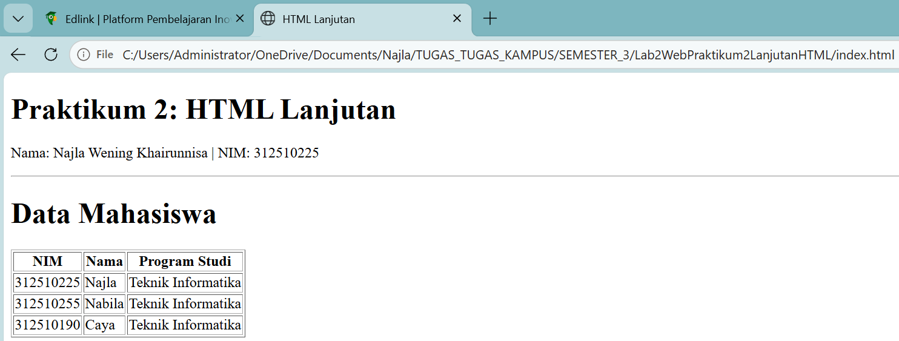
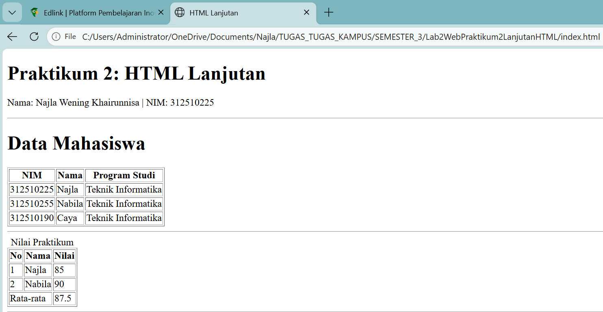
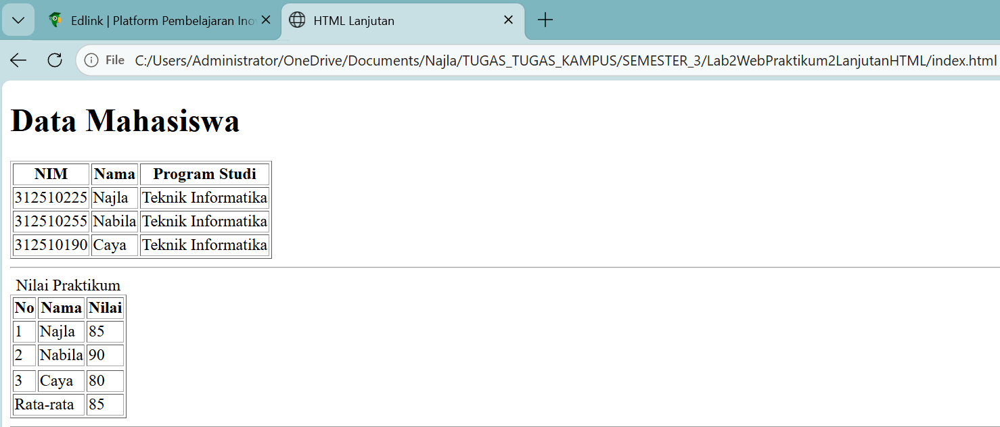
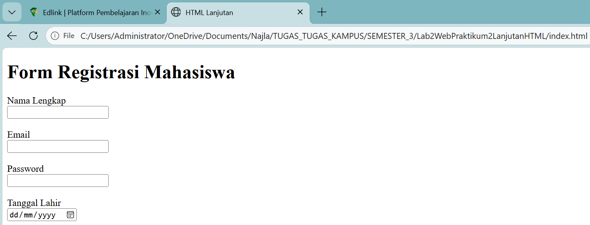
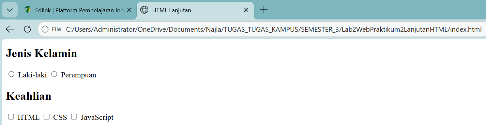
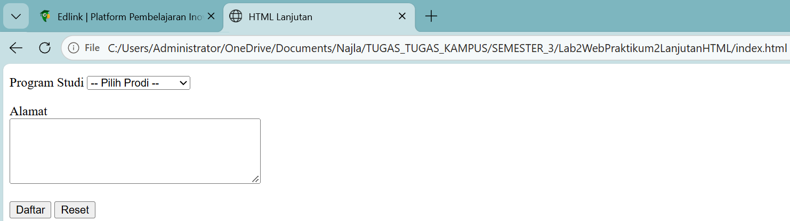
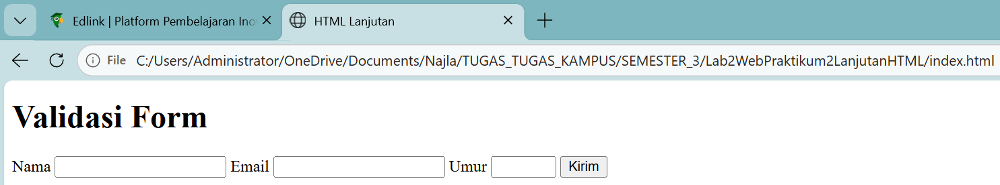
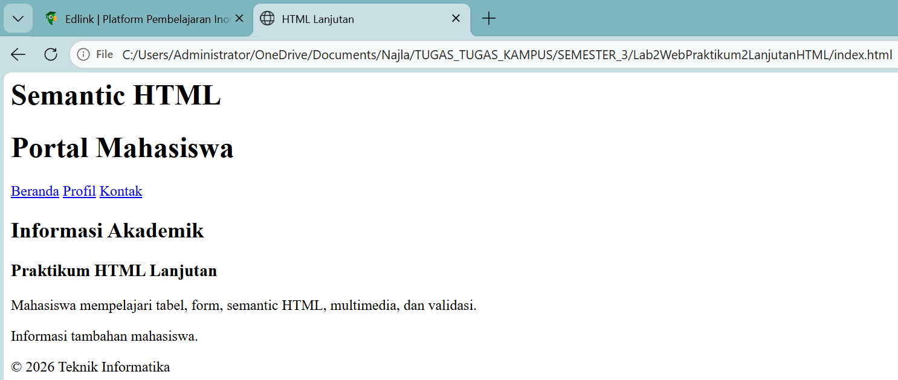
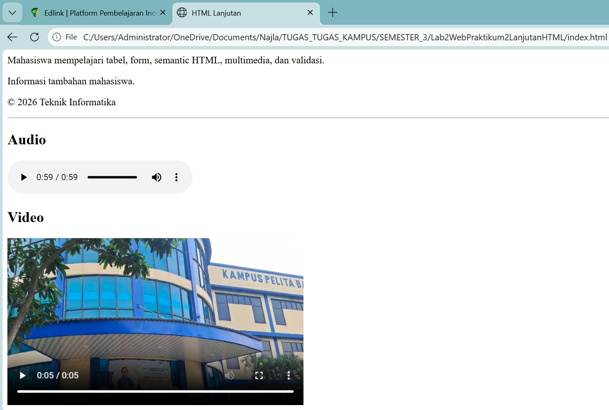
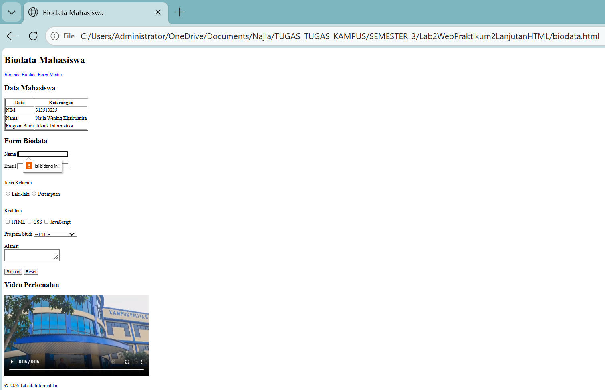

# Lab2Web - Praktikum 2: HTML Lanjutan

| | |
|---|---|
| **Mata Kuliah** | Pemrograman Web |
| **Nama** | Najla Wening Khairunnisa |
| **NIM** | 312510225 |
| **Program Studi** | Teknik Informatika |
| **Universitas** | Universitas Pelita Bangsa, Bekasi |

---

## Deskripsi

Praktikum ini adalah lanjutan dari HTML Dasar. Materi yang dipelajari adalah tabel, form dan berbagai jenis input, semantic HTML, multimedia (audio dan video), serta validasi form dasar menggunakan atribut HTML.

---

## Struktur Folder

```
Lab2WebPraktikum2LanjutanHTML/
├── index.html
├── biodata.html
├── media/
│   ├── audio.mp3
│   └── video.mp4
├── screenshots/
│   ├── 01-tabel-mahasiswa.png
│   ├── 02-tabel-thead-tbody-tfoot.png
│   ├── 02b-eksperimen-tabel.png
│   ├── 03-form-registrasi.png
│   ├── 04-radio-checkbox.png
│   ├── 05-select-textarea.png
│   ├── 06-validasi-form.png
│   ├── 07-semantic-html.png
│   ├── 08-media.png
│   ├── 09-biodata.png
│   └── 09b-biodata-validasi.png
└── README.md
```

---

## Langkah-langkah Praktikum

### Langkah 1: Membuat Tabel Data Mahasiswa

Pada langkah ini saya membuat tabel berisi NIM, Nama, dan Program Studi dengan 3 data mahasiswa. Elemen yang digunakan:

- `<table>` untuk membuat tabel
- `<tr>` untuk baris
- `<th>` untuk sel judul
- `<td>` untuk sel data



### Langkah 2: Mengembangkan Tabel dengan thead, tbody, dan tfoot

Tabel dibuat lebih terstruktur dengan `<caption>` sebagai judul, `<thead>` untuk bagian kepala, `<tbody>` untuk bagian isi, dan `<tfoot>` untuk bagian kaki tabel. Atribut `colspan` dipakai untuk menggabungkan dua sel pada baris Rata-rata.



**Eksperimen:** saya mengubah data, menambah baris, dan mencoba `colspan`.



### Langkah 3: Membuat Form Registrasi Mahasiswa

Saya membuat form registrasi dengan input:

- Nama (`text`)
- Email (`email`)
- Password (`password`)
- Tanggal lahir (`date`)

Setiap input dihubungkan dengan `<label>` lewat atribut `for` dan `id`. Form ini juga punya tombol Daftar (`submit`) dan Reset (`reset`).



### Langkah 4: Radio Button dan Checkbox

Saya menambahkan **radio button** untuk Jenis Kelamin (hanya bisa pilih satu) dan **checkbox** untuk Keahlian (bisa pilih lebih dari satu). Radio button memakai `name` yang sama (`jk`) supaya hanya satu yang bisa dipilih.



### Langkah 5: Select dan Textarea

Saya menambahkan `<select>` dengan `<option>` untuk memilih Program Studi, dan `<textarea>` untuk mengisi Alamat yang membutuhkan teks lebih panjang.



### Langkah 6: Validasi Form Dasar

Saya menambahkan validasi dengan atribut HTML:

- `required`: wajib diisi
- `minlength="3"`: nama minimal 3 karakter
- `min="17"` dan `max="60"`: umur 17 sampai 60 tahun

Ketika tombol Kirim ditekan tanpa mengisi data, browser menampilkan pesan peringatan.



### Langkah 7: Membuat Halaman Semantic HTML

Saya menyusun halaman dengan elemen semantic, yaitu `<header>`, `<nav>`, `<main>`, `<section>`, `<article>`, `<aside>`, dan `<footer>`.



### Langkah 8: Menambahkan Multimedia

Saya menambahkan elemen `<audio>` dan `<video>` dengan atribut `controls` supaya tombol pemutar muncul. File audio dan video disimpan di folder `media/`.



### Langkah 9: Proyek Mini - Form Biodata Mahasiswa

File: `biodata.html`

Pada proyek mini ini saya menggabungkan semua materi dalam satu halaman, yaitu semantic HTML, tabel data, form (input teks, email, radio, checkbox, select, textarea), validasi dasar, dan multimedia (video).


Tampilan validasi saat tombol Simpan ditekan tanpa mengisi data:



---

## Jawaban Pertanyaan

### 1. Apa fungsi `<table>`, `<tr>`, `<th>`, dan `<td>`?

- `<table>` berfungsi untuk membuat tabel.
- `<tr>` berfungsi untuk membuat baris di dalam tabel.
- `<th>` berfungsi untuk membuat sel judul (header) kolom atau baris.
- `<td>` berfungsi untuk membuat sel yang berisi data.

### 2. Apa perbedaan `<th>` dan `<td>`?

`<th>` dipakai untuk judul kolom atau baris, dan tampilannya otomatis tebal dan berada di tengah. Sedangkan `<td>` dipakai untuk isi data biasa dengan tampilan teks normal.

### 3. Apa fungsi `colspan` pada tabel?

`colspan` berfungsi untuk menggabungkan beberapa kolom menjadi satu sel. Contohnya `colspan="2"` membuat satu sel selebar dua kolom, seperti pada baris Rata-rata di tabel nilai.

### 4. Apa fungsi `<form>` dalam HTML?

`<form>` berfungsi untuk membuat formulir yang menerima data dari pengguna, misalnya nama, email, atau pilihan. Data tersebut dikirim ketika tombol submit ditekan.

### 5. Apa perbedaan radio button dan checkbox?

Radio button hanya bisa dipilih **satu** dari beberapa pilihan, misalnya Jenis Kelamin. Checkbox bisa dipilih **lebih dari satu**, misalnya Keahlian.

### 6. Mengapa `<label>` sebaiknya terhubung dengan id input melalui atribut `for`?

Supaya label dan input saling terhubung. Dengan begitu, saat teks label diklik, input-nya ikut aktif atau terpilih, sehingga lebih mudah dipakai, terutama untuk radio button dan checkbox yang ukurannya kecil. Hubungan ini juga membantu pengguna yang memakai screen reader.

### 7. Apa perbedaan `<textarea>` dengan input type text?

`<input type="text">` dipakai untuk teks pendek satu baris, seperti nama. `<textarea>` dipakai untuk teks panjang yang bisa terdiri dari banyak baris, seperti alamat. Ukuran `<textarea>` bisa diatur dengan `rows` dan `cols`.

### 8. Apa fungsi semantic HTML seperti `<header>`, `<nav>`, `<main>`, `<section>`, `<article>`, `<aside>`, dan `<footer>`?

- `<header>` untuk kepala halaman atau bagian.
- `<nav>` untuk menu navigasi atau kumpulan link.
- `<main>` untuk isi utama halaman.
- `<section>` untuk mengelompokkan isi yang topiknya sama.
- `<article>` untuk konten yang bisa berdiri sendiri, misalnya berita.
- `<aside>` untuk informasi tambahan atau pelengkap.
- `<footer>` untuk kaki halaman atau bagian.

Dengan elemen ini, struktur halaman jadi lebih jelas dan mudah dipahami, baik oleh pembuat web maupun mesin pencari.

### 9. Apa fungsi `required`, `min`, `max`, dan `minlength`?

- `required`: input harus diisi sebelum form bisa dikirim.
- `min`: batas nilai terkecil yang boleh diisi pada input angka.
- `max`: batas nilai terbesar yang boleh diisi pada input angka.
- `minlength`: jumlah huruf minimal yang harus diisi pada input teks.

### 10. Apa perbedaan elemen `<audio>` dan `<video>`?

`<audio>` dipakai untuk memutar suara saja, seperti musik atau rekaman, dan hanya menampilkan tombol pemutar. `<video>` dipakai untuk memutar video, jadi ada gambar dan suara, dan ukuran tampilannya bisa diatur, misalnya dengan `width`.

---

## Repository GitHub


URL repository: https://github.com/njlwng/Lab2Web
